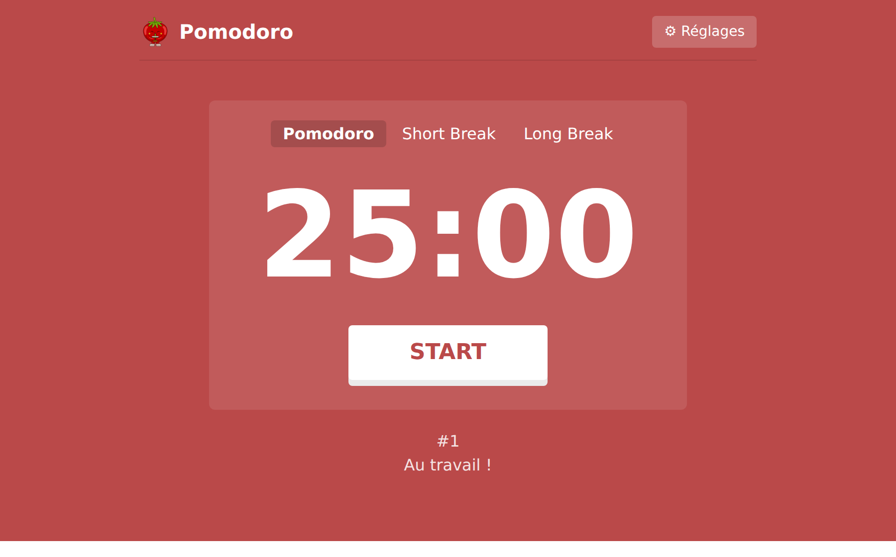
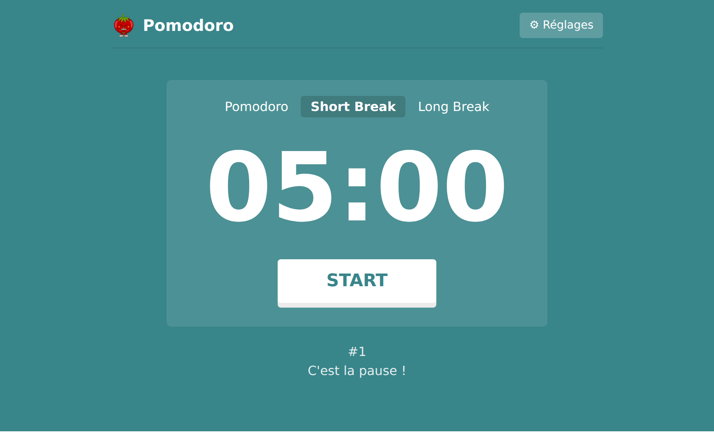
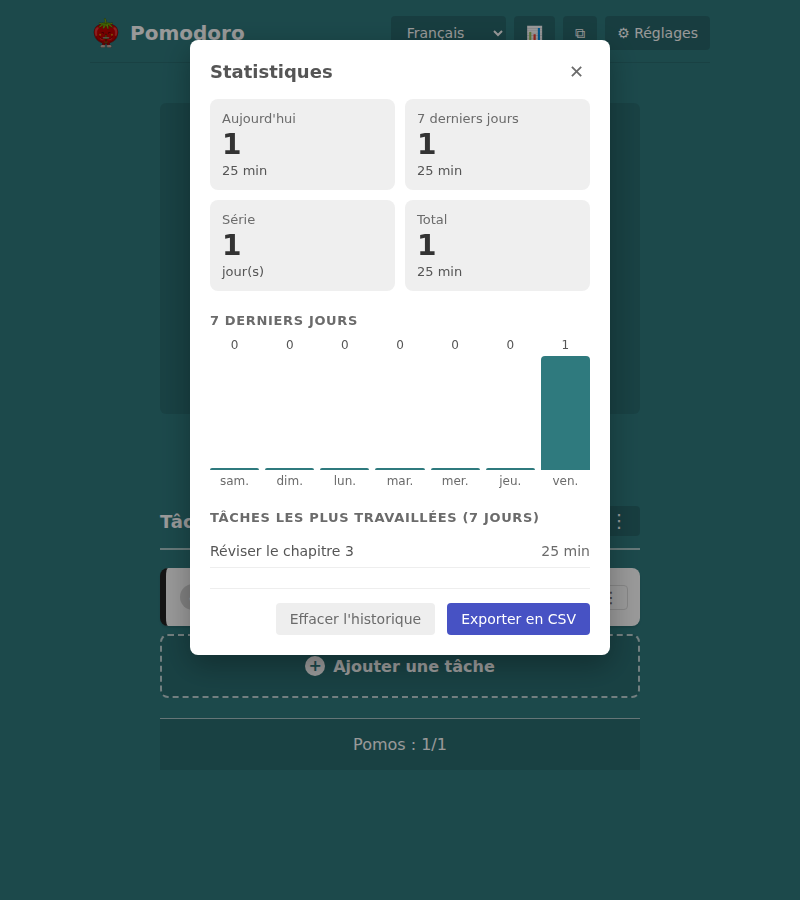
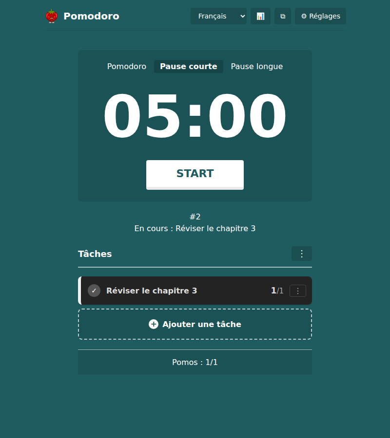
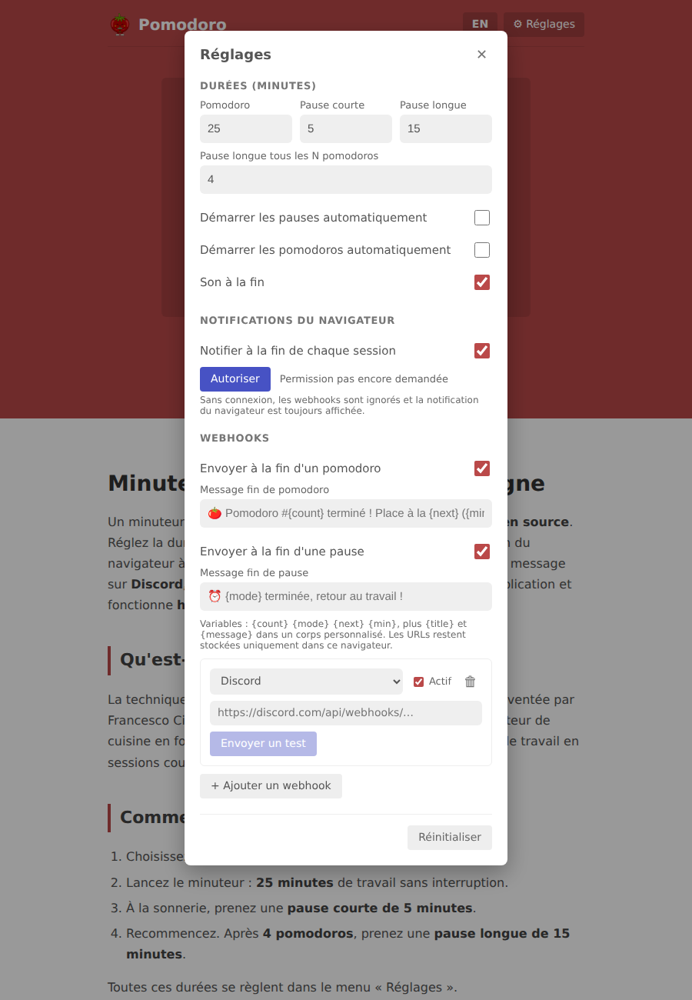
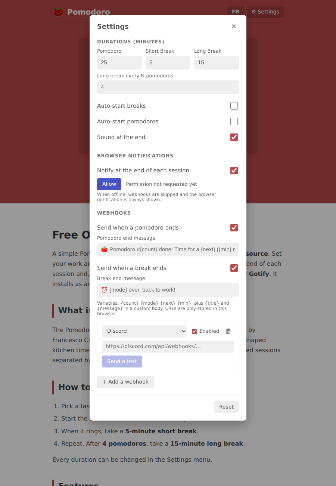
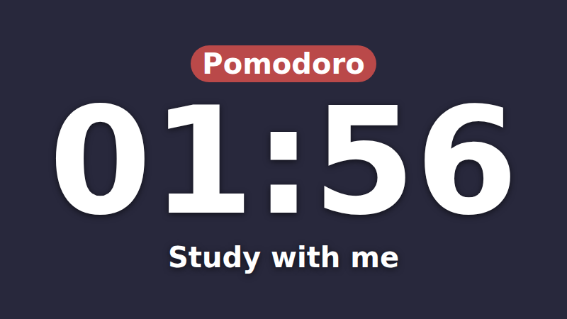

<div align="center">


# Pomodoro

**Minuteur Pomodoro gratuit, sans pub et open source, écrit en Rust et compilé en WebAssembly.**

Tâches · Statistiques · Mini-minuteur flottant · Overlay OBS · Webhooks Discord, Slack, ntfy · Hors ligne · 5 langues

[**▶ Essayer sur pomo.domesday.fr**](https://pomo.domesday.fr/) · [English](https://pomo.domesday.fr/en/) · [Español](https://pomo.domesday.fr/es/) · [Deutsch](https://pomo.domesday.fr/de/) · [Português](https://pomo.domesday.fr/pt/)

[](https://github.com/DOMESDAY7/pomo/actions/workflows/deploy.yml)


<br />




</div>

---

## Fonctionnalités

| | |
|---|---|
| ⏱ **Durées réglables** | Pomodoro, pause courte, pause longue et fréquence des pauses longues (25 / 5 / 15 min, une pause longue tous les 4 par défaut). |
| ✅ **Tâches** | Pomodoros estimés / réalisés par tâche, tâche active qui compte les pomodoros terminés, heure de fin prévue, notes, modèles réutilisables, import Todoist, masquer / vider la liste. Tout est gratuit, sans compte. |
| ⧉ **Mini-minuteur flottant** | Une petite fenêtre toujours au-dessus des autres applis (Document Picture-in-Picture, Chrome/Edge), synchronisée avec la page : démarrer, pause, passer. |
| 🎥 **Overlay OBS** | `?overlay=1` : fond transparent, minuteur seul, pour les streams « study with me ». L'URL est générée dans les réglages. |
| 📊 **Statistiques** | Pomodoros du jour, des 7 derniers jours (graphique), série de jours, total, tâches les plus travaillées, export CSV. |
| 🔊 **Sons** | Quatre sonneries synthétisées (aucun fichier à télécharger), volume, tic-tac, bruit blanc / rose / brun pendant les pomodoros. |
| ⌨️ **Raccourcis clavier** | Voir le tableau plus bas, ou <kbd>?</kbd> dans l'app. |
| 🌙 **Mode sombre** | Automatique (selon le système), clair ou sombre. |
| 🔁 **Démarrage automatique** | Enchaîne les pauses et les pomodoros sans cliquer, si tu le souhaites. |
| 🔔 **Notifications du navigateur** | Une notification et un signal sonore à la fin de chaque session, même dans l'application installée. |
| 🪝 **Webhooks** | Discord, Slack / Mattermost, ntfy, Gotify, ou n'importe quel service avec un corps de requête personnalisé. Plusieurs webhooks en même temps. |
| 📴 **Hors ligne** | Installable comme une application (PWA). Sans connexion, les webhooks sont ignorés et la notification du navigateur prend le relais. |
| 🔒 **Vie privée** | Aucun compte, aucun pistage, aucun serveur. Les réglages et les URLs de webhook restent dans le navigateur. |
| 🌍 **5 langues** | Français, anglais, espagnol, allemand, portugais : une page indexable par langue (`/`, `/en/`, `/es/`, `/de/`, `/pt/`) avec `hreflang`. L'interface, les messages par défaut et les notifications suivent la langue de la page. |
| ♿ **Accessible** | Contrastes conformes WCAG AA (vérifiés avec axe-core) dans les trois modes, en clair comme en sombre. |
| ⚡ **Léger** | Environ 200 Ko de WebAssembly, sans framework JS. |

Le temps est calculé à partir de l'heure de fin prévue : le minuteur reste exact même quand l'onglet est en arrière-plan. Le temps restant s'affiche dans le titre de l'onglet.

<div align="center">


<br />


</div>

## Raccourcis clavier

| Touche | Action |
|---|---|
| <kbd>Espace</kbd> | Démarrer / mettre en pause |
| <kbd>S</kbd> | Passer la session en cours |
| <kbd>1</kbd> <kbd>2</kbd> <kbd>3</kbd> | Pomodoro / pause courte / pause longue |
| <kbd>N</kbd> | Nouvelle tâche |
| <kbd>P</kbd> | Mini-minuteur flottant |
| <kbd>R</kbd> | Statistiques |
| <kbd>O</kbd> | Réglages |
| <kbd>?</kbd> | Liste des raccourcis |
| <kbd>Échap</kbd> | Fermer la fenêtre ouverte |

## Overlay OBS

<div align="center"></div>

Ajouter l'URL suivante comme **Source navigateur** dans OBS (les réglages de l'app la génèrent avec tes durées) :

```
https://pomo.domesday.fr/?overlay=1&pomo=25&short=5&long=15&interval=4&autostart=1&label=Study%20with%20me
```

| Paramètre | Effet |
|---|---|
| `overlay=1` | active le mode overlay (fond transparent, minuteur seul) |
| `pomo`, `short`, `long`, `interval` | durées en minutes et fréquence des pauses longues |
| `autostart=1` | démarre au chargement et enchaîne les sessions |
| `sound=1` | joue la sonnerie (capturable par OBS) |
| `label=…` | texte affiché sous le minuteur |

L'overlay n'enregistre rien : il ne touche ni aux réglages, ni aux tâches, ni aux statistiques de l'app ouverte dans le même navigateur. Dans OBS, clic droit → *Interagir* puis clic ou <kbd>Espace</kbd> pour démarrer / mettre en pause. Le préfixe de langue (`/en/`, `/de/`…) traduit le nom des sessions.

## Webhooks

Chaque service attend son propre format. Le minuteur construit la bonne requête selon le type choisi :

| Type | Format envoyé | URL attendue |
|---|---|---|
| **Discord** | `multipart/form-data` avec `payload_json` (`{"content": …}`) | `https://discord.com/api/webhooks/…` |
| **Slack / Mattermost** | `application/x-www-form-urlencoded`, `payload={"text": …}` | `https://hooks.slack.com/services/…` |
| **ntfy** | `text/plain`, titre passé en paramètre `?title=` | `https://ntfy.sh/mon-topic` |
| **Gotify** | `application/x-www-form-urlencoded` (`title`, `message`, `priority`) | `https://gotify.exemple.fr/message?token=…` |
| **Personnalisé** | Méthode, `Content-Type` et corps au choix | n'importe quelle URL |

Les messages sont des modèles avec des variables :

| Variable | Valeur |
|---|---|
| `{count}` | numéro du pomodoro terminé |
| `{mode}` | session qui vient de se terminer |
| `{next}` | session suivante |
| `{min}` | durée de la session suivante, en minutes |
| `{task}` | titre de la tâche active |
| `{title}`, `{message}` | titre et message rendus (corps personnalisé uniquement) |

Dans un corps personnalisé, les valeurs sont échappées automatiquement selon le `Content-Type` (JSON ou form-urlencoded).

> [!NOTE]
> Les requêtes partent directement du navigateur, donc la cible doit accepter le CORS. Discord et ntfy l'acceptent. Pour Slack et Gotify, le message est envoyé en mode `no-cors` : il arrive bien, mais le navigateur ne peut pas lire la réponse (« envoyé (réponse non lisible) »). En mode personnalisé, un `Content-Type` autre que `text/plain` ou `form-urlencoded` déclenche un preflight CORS que le serveur doit accepter.

> [!WARNING]
> Une URL de webhook suffit pour poster sur ton salon. Elle reste stockée dans le `localStorage` de ton navigateur. Ne la partage pas et ne la commite pas.

## Développement

Prérequis : [Rust](https://rustup.rs), [trunk](https://trunkrs.dev) et `python3` (pour le hook qui génère les pages traduites).

```bash
rustup target add wasm32-unknown-unknown
cargo install trunk      # ou un binaire précompilé depuis les releases GitHub

trunk serve --open       # serveur de dev avec rechargement automatique
trunk build --release    # build optimisé dans dist/
```

### Structure

```
src/
├── main.rs       # UI Leptos, état du minuteur, réglages, overlay OBS, raccourcis
├── i18n.rs       # textes des 5 langues, langue lue dans <html lang>
├── audio.rs      # sonneries, tic-tac et bruits synthétisés (Web Audio)
├── stats.rs      # historique, statistiques, export CSV
├── pip.rs        # mini-minuteur flottant (Document Picture-in-Picture)
├── tasks.rs      # liste de tâches, modèles, import Todoist
├── webhook.rs    # formats par service, envoi des requêtes
└── notify.rs     # notifications navigateur (via le service worker si présent)
index.html        # point d'entrée trunk + contenu statique FR, méta SEO, JSON-LD
i18n/<langue>.html   # blocs traduits qui remplacent les zones <!-- i18n:… --> d'index.html
scripts/build_lang_pages.py  # hook post_build (Trunk.toml) qui génère dist/<langue>/index.html
style.css
sw.js             # service worker : cache hors ligne, clic sur notification
manifest.webmanifest
icons/            # icônes PWA générées depuis la mascotte
```

## Déploiement

Le workflow [`.github/workflows/deploy.yml`](.github/workflows/deploy.yml) compile avec trunk et publie sur **GitHub Pages** à chaque push sur `main`.

1. Dans *Settings → Pages*, choisir **GitHub Actions** comme source.
2. Domaine personnalisé : un `CNAME` vers `<user>.github.io` chez le fournisseur DNS, puis renseigner le domaine dans *Settings → Pages* et activer *Enforce HTTPS*.

Le build cible la racine du domaine (`--public-url /`). Pour servir le site sous `https://<user>.github.io/<repo>/`, remplacer par `--public-url /<repo>/`.

## Stack

- [Leptos](https://leptos.dev) 0.8 en mode CSR, réactivité fine sans DOM virtuel
- [wasm-bindgen](https://github.com/rustwasm/wasm-bindgen) / [web-sys](https://docs.rs/web-sys) pour les API du navigateur (Fetch, Notifications, Web Audio, Service Worker)
- [trunk](https://trunkrs.dev) pour le build, avec `wasm-opt -Oz`

### Traductions

Les textes de l'application sont dans `src/i18n.rs`, un `Strings` par langue : le compilateur refuse une traduction incomplète. Le contenu statique (titre, description, FAQ, JSON-LD) est dans `index.html` pour le français et dans `i18n/<langue>.html` pour les autres langues. Une question de FAQ doit être identique dans le texte visible et dans le JSON-LD de la même page.

Pour ajouter une langue : une variante dans `Lang` et un `Strings` dans `src/i18n.rs`, un fichier `i18n/<code>.html`, puis les liens `hreflang` d'`index.html`, le `sitemap.xml` et la liste du service worker.

### Mesure d'audience

[GoatCounter](https://www.goatcounter.com/) compte les pages vues sans cookie ni donnée personnelle. Le script est chargé dans le `<head>` commun à toutes les langues.

### Import Todoist

L'import appelle directement l'API Todoist depuis le navigateur (`api/v1`, avec repli sur `rest/v2`). Il faut un jeton personnel : *Todoist → Paramètres → Intégrations → Développeur*. Le filtre par défaut est `today | overdue`, et un champ vide importe toutes les tâches. Une tâche déjà importée n'est pas ajoutée une deuxième fois.
